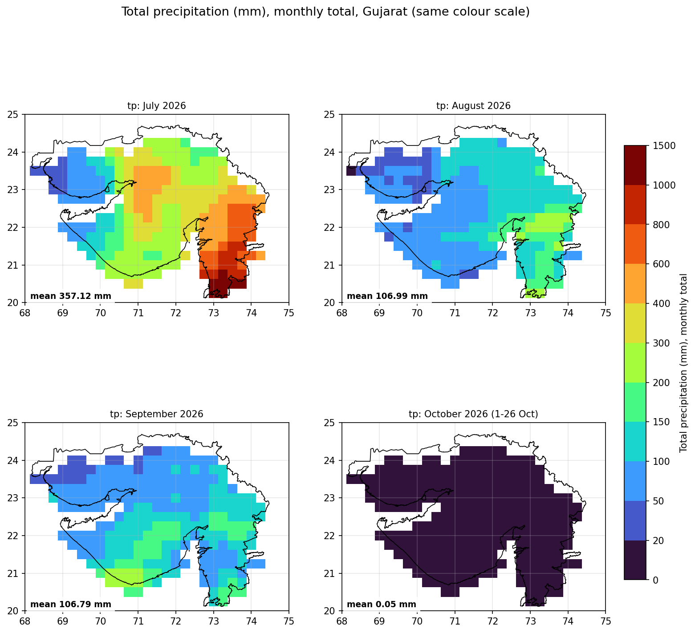
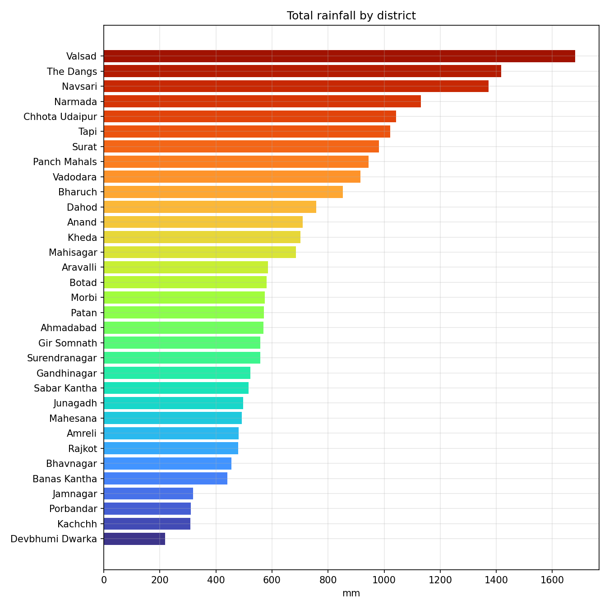
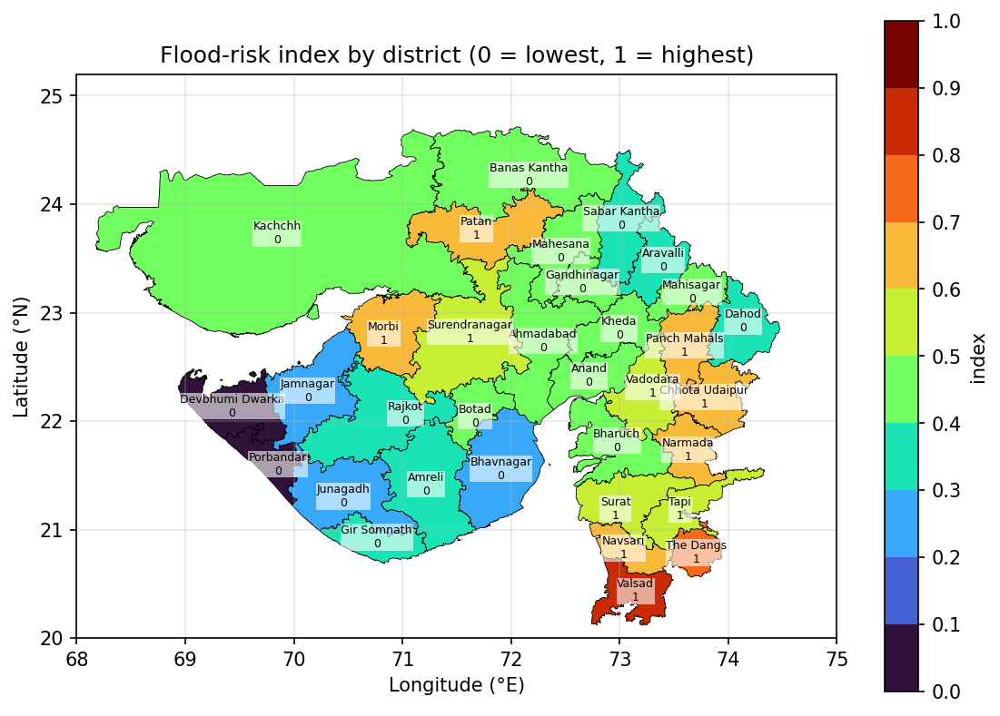
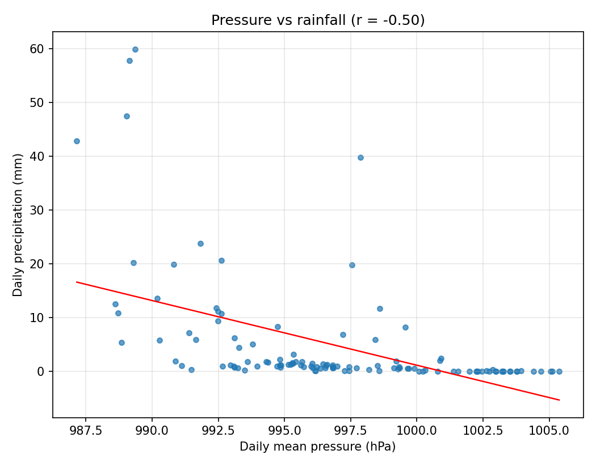
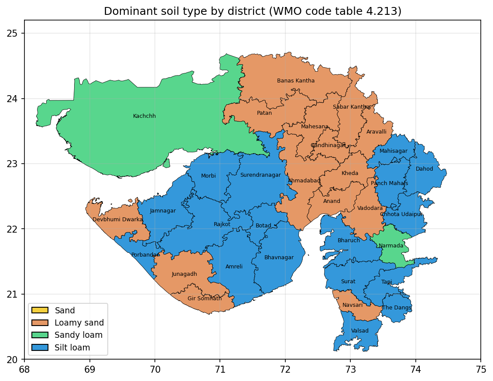
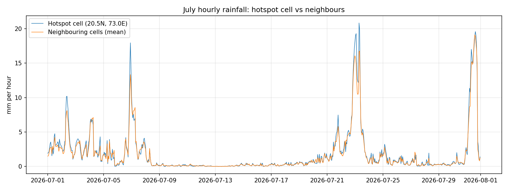

# Gujarat Monsoon 2026: District Rainfall, Flood-Risk and Soil Analysis

An end-to-end, reproducible analysis of the 2026 monsoon across all **33 districts of Gujarat, India** (1 July to 26 October 2026). It turns raw ECMWF weather data into district-level statistics, maps, charts and a findings report, and runs in **Google Colab** or on a local machine.



---

## Highlights

- **571 mm** of rain fell on average across Gujarat. **July produced 63%** of it; October was almost dry.
- **Valsad** was the wettest district (**1,682 mm**); **Devbhumi Dwarka** the driest (**219 mm**).
- The **wettest week** began 20 July (187 mm on average). **27 of 33 districts** received at least 100 mm that week.
- **Rain came in spells:** longest wet spell 23 days (14 Jul – 5 Aug); longest dry spell 36 days (21 Sep – 26 Oct).
- A **flood-risk ranking** (a relative index, not a forecast) puts Valsad, The Dangs and Navsari highest.
- **Rain and pressure move in opposite directions** (daily r = −0.50). Convective rain rate tracks total rain closely (r = 0.90).
- **17 of 33 districts** sit mainly on **silt loam**, including several of the wettest.

---

## Repository layout

```
gujarat-monsoon-analysis/
├── notebooks/
│   └── gujarat_monsoon_analysis.ipynb   # Colab notebook (main entry point)
├── src/
│   ├── gujarat_monsoon_analysis.py      # same pipeline as a plain Python script
├── data/
│   ├── data_grib.zip                    # ECMWF GRIB file (zipped, ~11 MB)
│   └── gujarat_districts.kml            # 33 district boundaries
├── results/
│   ├── analysis_outputs.zip             # every table and chart from the final run (112 PNG)
│   ├── insights.md                      # automatically generated findings
│   ├── soil_insights.md                 # soil-type findings
│   ├── tables/                          # key CSV tables (district summary, flood-risk index, ...)
│   └── figures/                         # selected charts used in this README
├── requirements.txt
├── .gitignore
└── README.md
```

---

## Quick start

### Option A: Google Colab (no installation)

1. Open `notebooks/gujarat_monsoon_analysis.ipynb` in Colab (*File → Upload notebook*, or open it from GitHub).
2. Select **Runtime → Run all**.
3. If the data files are not found, Colab asks you to upload `data_grib.zip` (or the `.grib` file) and `gujarat_districts.kml`. Otherwise it uses the copies in `data/`.

The first run takes a few minutes. Results appear in `analysis_outputs/`, and the notebook packages them into `analysis_outputs.zip` for download.

### Option B: Local machine

```bash
git clone https://github.com/<your-username>/gujarat-monsoon-analysis.git
cd gujarat-monsoon-analysis
pip install -r requirements.txt
python src/gujarat_monsoon_analysis.py
```

Run it from the repository root. The script finds `data/data_grib.zip` and unpacks it automatically. Python 3.9 or later is required; the code was tested on Python 3.12.

### Using your own data

- **Different month or year:** replace the GRIB zip in `data/` with one covering your period. The code reads the period from the file.
- **Different boundaries:** replace `gujarat_districts.kml`. Each placemark becomes a district, and its name is used throughout.
- **Baseline comparison:** add a multi-year GRIB file named `baseline*.grib` (same grid and variables) to `data/`. The pipeline then writes rainfall as a percentage of the normal for each district and month. Without it, that step is skipped.

---

## Data

| Item | Detail |
|---|---|
| Producer | ECMWF (European Centre for Medium-Range Weather Forecasts). The file has forecast-style step numbers; the exact product name is not stored in it, so confirm it from the download source before publishing. |
| Format | GRIB edition 1, regular latitude–longitude grid |
| Grid | 21 × 29 points (609 cells), 0.25° spacing, covering 20–25°N and 68–75°E (about 27 km per cell) |
| Period | 1 July 2026 00:00 to 26 October 2026 17:00 (2,826 hours, no gaps) |
| Variables | 2 m temperature, surface pressure, total precipitation, convective precipitation, convective rain rate, precipitation type, soil type |
| Boundaries | 33 Gujarat districts from a KML file (each cell belongs to a district when its centre falls inside it) |

**Variable details**

| Short name | Variable | Units in file | Converted to | Notes |
|---|---|---|---|---|
| `2t` | 2 m temperature | K | °C | |
| `sp` | Surface pressure | Pa | hPa | |
| `tp` | Total precipitation | m per hour | mm per hour | Negative values: none found |
| `cp` | Convective precipitation | m per hour | mm per hour | |
| `crr` | Convective rain rate | kg m⁻² s⁻¹ | mm/h | |
| `ptype` | Precipitation type | code table 4.201 | % of hours with rain | Only 0 and 1 occur; 1 is treated as rain |
| `slt` | Soil type | code table 4.213 | soil class | Static. Codes: 0 reserved (mostly coastal), 1 sand, 2 loamy sand, 3 sandy loam, 4 silt loam (WMO table, from the eccodes repository on GitHub) |

**Coverage limits:** the file has no wind, humidity, cloud or pressure-level fields, and no multi-year history.

---

## Method

### 1. Read and convert
Every GRIB message is read directly with `eccodes`. Reading message by message avoids the time-axis merge problem that `cfgrib`/`xarray` has with this file. Units are converted as listed above.

### 2. Assign grid cells to districts
Each district's membership is a row of a 33 × 609 matrix: a cell belongs to a district when its centre lies inside it. A district with no cell centre inside it takes its nearest cell. Botad, Gandhinagar, Mahisagar and The Dangs contain only three cells each, so their values are less reliable.

### 3. Aggregate in time
Hourly values are aggregated to daily, weekly (weeks start on Monday) and monthly resolution:
- **Totals** for precipitation (sums)
- **Means** for temperature, pressure, rain rate and rain-hour share
- **Maximum and minimum** for temperature

### 4. Statistics, rankings and relationships
District summaries, rankings, heatmaps, Pearson correlations between daily variables, and scatter plots with fitted lines.

### 5. Flood-risk index (relative ranking)

| Measure | Definition | Why it matters |
|---|---|---|
| Largest 3-day rainfall | Highest 72-hour total | Short, intense spells drive flash floods |
| Heavy-rain days | Days with at least 20 mm | Repeated heavy days saturate the ground |
| Rain per rain hour | Total rain ÷ hours with rain | Heavier rain when it falls |
| Top-5-days share | Share of the season's rain on the 5 wettest days | Concentrated rain runs off faster |

Each measure is scaled to 0–1 across districts (`(value − min) / (max − min)`), and the four scores are averaged with equal weight. The index is a **relative ranking**. It does not predict floods or estimate damage.

### 6. Hotspot check
The July maximum is compared with its neighbouring cells. A ratio far above 1, with rain concentrated in a few hours, would indicate a single-cell error. The hotspot cell's total is **1.08×** its neighbours, and rain fell on **633 hours**, with only **14%** of the total in the ten heaviest hours. This pattern is consistent with a broad rain system, but it still needs checking against station records.

### 7. Soil analysis
- **Dominant soil per district** and a composition chart.
- **Rain, convection and temperature by soil class**, per grid cell. Soil and location are mixed together, so these differences do not show soil causing the rain pattern.
- **Runoff susceptibility vs flood risk.** This uses an *assumption from hydrology*, not from the dataset: finer soils infiltrate less and produce more runoff. The charts label it as assumption-based.

### 8. Optional baseline
If `baseline*.grib` is present, each district's July–October rainfall is compared with the multi-year average for the same months.

---

---

## Verification and reproducibility

The reference run is the output of the notebook run in Google Colab (`results/reference/colab_run_analysis_outputs.zip`). A new run is checked against it with:

```bash
python src/gujarat_monsoon_analysis.py
python src/verify_outputs.py analysis_outputs
```

The check confirms that:
1. every reference file exists in the new run (112 PNG and 17 CSV files, plus the text reports);
2. every CSV has the same columns and row labels;
3. every number agrees within 0.05 (the tolerance absorbs rounding differences between platforms).

**Verified results:** a local run and the Colab run both pass. The only differences are in the last decimal place of a few district totals (for example 1,416.94 mm vs 1,416.95 mm), from floating-point rounding. The insights reports and soil findings are byte-identical.

**Continuous integration:** `.github/workflows/pipeline.yml` runs the pipeline and the verification on every push and pull request, then uploads the results as a build artifact. A failing check means a change has altered the results, which should be reviewed before merging.

## Results

### Rainfall
| Month | Gujarat mean rain | Share of season |
|---|---|---|
| July 2026 | 357 mm | 63% |
| August 2026 | 107 mm | 19% |
| September 2026 | 107 mm | 19% |
| October 2026 (1–26 Oct) | ≈0 mm | ≈0% |
| **Season** | **571 mm** | 100% |

Wettest district: **Valsad** 1,682 mm. Then The Dangs 1,417 mm and Navsari 1,372 mm. Driest: **Devbhumi Dwarka** 219 mm.



### Timing
- Wettest day in Gujarat: **24 July** (59.9 mm, area mean).
- Wettest week: **20 July** (187 mm). 27 districts received at least 100 mm.
- Longest wet spell: 23 days (14 July – 5 August). Longest dry spell: 36 days (21 September – 26 October).
- Valsad had the most days with at least 20 mm (18 days).

### Flood-risk ranking (top 5)

| Rank | District | Index (0–1) | Heavy days | Top-5-days share |
|---|---|---|---|---|
| 1 | Valsad | 0.82 | 18 | 45% |
| 2 | The Dangs | 0.71 | 16 | 46% |
| 3 | Navsari | 0.69 | 14 | 47% |
| 4 | Narmada | 0.65 | 16 | 46% |
| 5 | Patan | 0.65 | 8 | **66%** |



Patan and Morbi (68%) stand out because most of their rain fell on just five days. The wettest south-east districts rank highest mainly on heavy-day counts and intensity.

### Temperature and pressure
- Warmest district on average: **Kachchh** (29.9 °C). Highest temperature: **42.0 °C** in Kachchh; three districts reached 40 °C at least once.
- Lowest Gujarat-mean pressure: 985 hPa on 31 July. Mean pressure rose from about 992 hPa in July to 1,003 hPa in October.
- Rain and pressure move in opposite directions (daily r = −0.50).



### Soil
- Silt loam dominates 17 of 33 districts, including Valsad, The Dangs, Chhota Udaipur, Tapi and Surat.
- Kachchh is about 74% sandy loam by grid cell.
- Runoff susceptibility and the flood-risk index are only weakly correlated (r = 0.23). Soil alone does not explain which districts are most exposed.



### July hotspot
The hotspot cell (20.5°N, 73.0°E) totals 1,398 mm, and its neighbours average 1,298 mm. Its hourly rain tracks the neighbourhood closely, which is what a broad system looks like.



---

## Outputs

Running the pipeline writes to `analysis_outputs/` (112 PNG charts and 17 CSV tables). Main folders:

| Folder | Contents |
|---|---|
| `tables/` | Daily, weekly and monthly tables for Gujarat and each district; district summary; flood-risk index; soil tables; correlation matrix; hotspot check |
| `timeseries/` | Line and bar charts for each variable at each resolution, plus stacked all-variable charts |
| `district_maps/` | Monthly and full-period district maps filled by value (precipitation, temperature, pressure, rain-hour share, convective rain, soil) |
| `district_grids/` | Daily district precipitation maps (every day) and weekly maps (every week) |
| `heatmaps/` | District × month, × week and × day precipitation; monthly temperature; soil composition |
| `rankings/` | Rankings by rainfall, temperature, rain-hour share, convective share, intensity and pressure |
| `grid_maps/` | Pixel-level maps for each variable, clipped to Gujarat (monthly and four-month panels) |
| `relationships/` | Correlation heatmap, scatter plots, cumulative rain and wet/dry days, soil-class comparisons |
| `insights/` | Flood-risk maps and ranking, soil vs runoff chart, districts frequency vs amount, `insights.md` |

---

## Reproducibility

- The pipeline is deterministic: the same input gives the same outputs.
- Versions tested: Python 3.12, numpy, pandas 2.x, matplotlib 3.x, eccodes 2.50, shapely 2.x.
- Run time on a standard machine: a few minutes. Most of the time goes to rendering the charts and maps (112 PNG files).

---

## Limitations

1. **Model data, not measurements.** Results describe the model's rainfall, not what fell on the ground. Validate against IMD or district rain-gauge records before drawing policy conclusions.
2. **Coarse resolution.** A 0.25° cell covers about 27 km. District values average a few cells, and small districts average very few.
3. **Single season, no baseline.** Without several years of data, the analysis cannot say whether 2026 was wetter or drier than normal. The baseline hook is ready for that data.
4. **The flood-risk index is relative and rainfall-only.** It ignores elevation, drainage, river capacity, urban cover and population, and its four measures are weighted equally. Changing the weights would change the ranking.
5. **Soil is from the model, and its link to runoff is an assumption.** Check soil against the NBSS&LUP soil survey for planning use.
6. **Boundaries.** The KML's district list may not match the current official list in every detail. Check names against the latest official source for formal use.

---
## Author

Maharshi K. Patel

[DAIICT (Dhirubhai Ambani Institute of Information and Communication Technology) · IIRS-ISRO]

---

## Licence

Add a licence before publishing (for example MIT for the code). Data remains under the terms of its providers: ECMWF data is subject to its own licence, so check it before redistribution.

## Acknowledgements

- ECMWF for the weather data.
- WMO code tables (via the eccodes project) for the soil and precipitation-type definitions.
- The `eccodes`, `shapely`, `numpy`, `pandas` and `matplotlib` developers.

---

*Built as an end-to-end data project. Questions and corrections are welcome through issues.*
